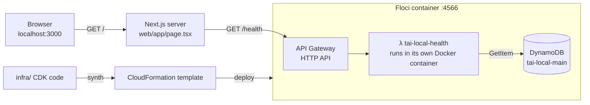

# Step 1: Skeleton + Floci spike

## What got built

- **Floci** (local AWS) running in Docker, from `docker-compose.yml`.
- A **CDK app** (`infra/`) that describes our AWS setup in TypeScript.
- One **DynamoDB table** (`tai-local-main`) that every later feature shares. It already has a change stream (step 6), TTL (step 4) and a second index, GSI1 (step 3).
- One **Lambda** (`tai-local-health`) behind an **HTTP API**: `GET /health` reads the table and says whether it answered.
- A **Next.js page** that calls `/health` from the server and shows "Backend is up".
- A **spike**: a throwaway stack that tested the features we weren't sure Floci supports. **9/10 work.** See [floci-compat.md](floci-compat.md).

## How a request travels



## Why it's built this way

**Infrastructure as code.** CDK writes a CloudFormation template (`infra/cdk.out/tai-local-core.template.json`, open it), and CloudFormation creates the resources. The same code deploys to Floci now and to AWS in step 11.

**A safety guard.** `infra/lib/config.ts` refuses `stage=local` unless `AWS_ENDPOINT_URL` points at Floci, and refuses `stage=aws` while it does. Every difference between local and AWS lives in that one file (region, CPU type, keep-or-delete data).

**A "paved road" for Lambdas.** `infra/lib/fn.ts` builds every function the same way: Node 22, esbuild bundle, source maps, consistent names. Platform teams do this so 50 services don't have 50 different setups.

**Least privilege.** `table.grantReadData(health)` gives the health Lambda read access to one table, nothing more. A test (`core-stack.test.ts`) fails if someone later gives it write access.

**Testable handlers.** `health.ts` takes its database call as a parameter, so the unit test passes a fake one. No table needed to test the logic.

**Spike first.** Before building on WebSocket push, Lambda streaming and DynamoDB Streams, we proved each one works locally. The streaming test failed, so we know now, not in step 5.

## What the spike found

| Works on Floci | Doesn't |
|---|---|
| WebSocket `$connect` authorizer, push with `PostToConnection`, `$disconnect`, 410 for dead connections | **Function URL streaming**: headers arrive, body is empty |
| DynamoDB Streams → Lambda with filters (INSERT only, key prefix) | Bedrock is a stub (fixed text), which is fine: we use our own mock |

The Lambda itself streamed fine (`aws lambda invoke` showed all 6 events), so the bug is in Floci's Function URL layer. We reported it: [floci#7837](https://github.com/floci-io/floci/issues/7837). Plan for step 5: locally, the AI handler runs in a small Node server that mimics Lambda streaming.

## How to navigate

Open these in VS Code, in this order:

1. `package.json` (root): the `scripts` are your commands. `workspaces` lists the four parts.
2. `docker-compose.yml`: how Floci starts, and why each setting is there.
3. `infra/bin/app.ts` → `infra/lib/config.ts` → `infra/lib/core-stack.ts` → `infra/lib/fn.ts`: the infrastructure, top down.
4. `services/src/health.ts` → `services/src/lib/*.ts`: the Lambda code.
5. `web/app/page.tsx`: the page (a server component).
6. `scripts/src/deploy-local.ts` → `scripts/src/cdk.ts`: what `npm run deploy:local` does.
7. `infra/lib/spike-stack.ts` + `scripts/src/spike-check.ts`: the spike, if you're curious.

| Folder | What's in it |
|---|---|
| `infra/` | CDK: what AWS resources exist |
| `services/` | Lambda handler code |
| `web/` | Next.js app |
| `scripts/` | deploy, spike and (later) seed and smoke-test scripts |
| `docs/learn/` | these docs |

## Poke it

Docker Desktop must be running first.

```powershell
cd C:\comdingbaamzi\aws-teams-ai
npm run floci:up          # start local AWS
npm run deploy:local      # deploy; prints your local API URL
npm run dev               # then open http://localhost:3000
npm test                  # 15 unit + template tests
npm run spike             # re-run the Floci check (~3 min)
```

Talk to Floci with the AWS CLI. Set these once per terminal:

```powershell
$env:AWS_ENDPOINT_URL="http://localhost:4566"; $env:AWS_ACCESS_KEY_ID="test"; $env:AWS_SECRET_ACCESS_KEY="test"; $env:AWS_DEFAULT_REGION="us-east-1"

aws dynamodb describe-table --table-name tai-local-main --query "Table.[TableStatus,StreamSpecification]"
aws lambda list-functions --query "Functions[].FunctionName"
aws cloudformation describe-stacks --stack-name tai-local-core --query "Stacks[0].Outputs"
docker ps                 # Floci + one container per warm Lambda
docker logs floci --tail 30
```

Try this: break it on purpose. In `core-stack.ts`, delete the `this.table.grantReadData(health);` line, run `npm test`, and watch the template test go red. Then `npm run deploy:local` and reload the page: it still says "Backend is up". **Floci doesn't enforce IAM** (we tested this), so only the template test caught the mistake. On real AWS the page would show "Backend is down" with an `AccessDeniedException` in the logs. That's why template tests matter. Put the line back.

## Interview angle

- *"How do you manage environments?"* Same IaC with a stage parameter, plus guardrails against deploying to the wrong place.
- *"Why serverless?"* No servers to patch, scales to zero, pay per request. Tradeoffs: cold starts, time limits, lock-in.
- *"How do you test cloud code?"* Unit tests with fakes, template tests on the IaC, an emulator for the fast loop, a real cloud environment for what emulators fake (IAM, limits, timing).
- *"How do you de-risk a new technology?"* A spike: the smallest test of the riskiest part, done first.

## How big companies do it

| Here | At scale |
|---|---|
| One stack, two stages | Many stacks per service, an **AWS account per environment** (dev / staging / prod) via AWS Organizations |
| `cdk deploy` from a laptop | **CI/CD**: PR → tests → deploy to staging → approval → prod (step 11 adds GitHub Actions) |
| Emulator for local testing | Emulator for the fast loop **plus** short-lived cloud environments per pull request |
| `/health` reads one item | Separate **liveness** (process up?) and **readiness** (dependencies up?) checks, used by load balancers to route around bad instances |
