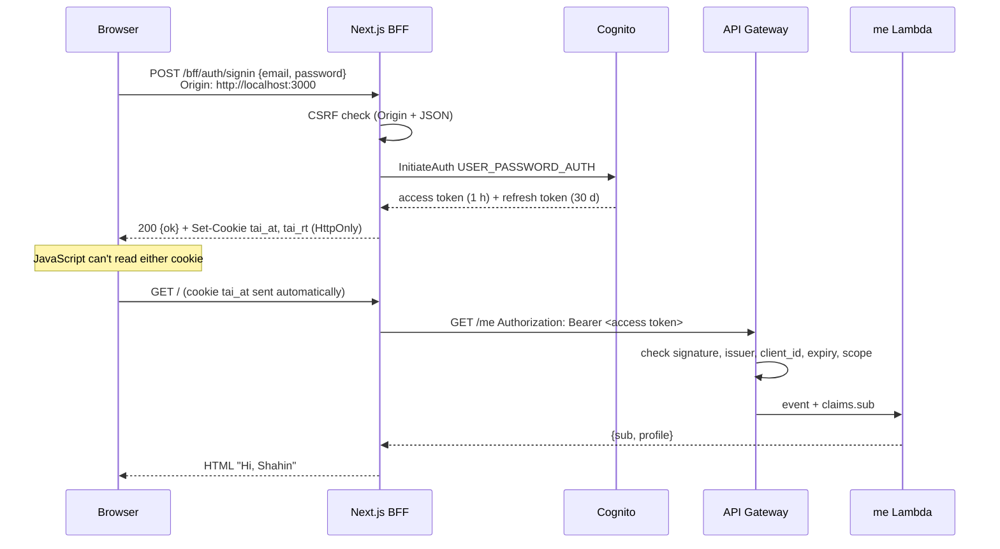

# Step 2: Login (Cognito, BFF, httpOnly cookies, CSRF)

## What got built

- A **Cognito user pool** (`tai-local-users`): the user list and passwords. Sign in with **email**, confirmed by a **6-digit code**.
- A **JWT authorizer** on the HTTP API. `GET /me` and `PUT /me` need a valid **access token**; `/health` stays public.
- A **`me` Lambda**: your profile, with a unique **@handle** (a DynamoDB transaction makes it unique).
- The **BFF** (`web/app/bff/`): 14 small route handlers. The browser only talks to them, and they talk to Cognito and the API.
- **Pages:** `/signup` → `/verify` → `/login` → `/onboarding` (pick @handle) → `/` (home) → `/settings` (profile, authenticator app, sign out everywhere). Plus `/forgot`.
- **Tests:** 62 unit tests, 2 integration tests on real DynamoDB, and a 15-step end-to-end smoke test (`npm run smoke:auth`).

## Sign-in, then one request



When the access cookie runs out (after about an hour), the page redirects to `/bff/auth/refresh?next=/`. That route swaps the refresh token for a new access token and sends you back. You don't notice anything.

## The ideas to learn

**1. Authentication vs authorization.** *Authentication* answers "who are you?": Cognito checks the password and hands out a token. *Authorization* answers "what may you do?": the `me` Lambda only edits the profile of the `sub` in the token, never an id from the request body. The unit test `me.test.ts` sends `sub: "someone-else"` in the body to prove it's ignored.

**2. Three tokens, three jobs.** Decode one at https://jwt.io (decoding is safe: JWTs are signed, not encrypted).

| token | says | for | lifetime |
|---|---|---|---|
| ID | who you are (email) | the app | 1 h |
| **access** | what you may do (`scope`, `client_id`) | **APIs** | 1 h |
| refresh | "give me new ones" | Cognito only | 30 days |

We send the access token. The route requires the scope `aws.cognito.signin.user.admin`, so an ID token gets **403**. We tested that, and without the scope rule both tokens got in.

**3. Why cookies and a BFF.** If tokens were in `localStorage`, any injected script (XSS) could read and send them anywhere. `HttpOnly` cookies are invisible to JavaScript. The browser attaches them, and only our server reads them. The refresh token's cookie has `Path=/bff/auth`, so it's only sent to the auth routes, never to pages.

**4. CSRF.** Cookies ride along automatically, even on a request another site triggers. So every BFF POST must (a) carry `Origin: <our site>` and (b) be JSON. A hidden form on `evil.com` fails both. All of that lives in one wrapper, `bffPost()`, so no route can forget it.

**5. Uniqueness without UNIQUE.** `HANDLE#ann` is a "claim" item, created only if it doesn't exist, in the same transaction as your profile. The integration test fires 20 sign-ups for one handle at once, and exactly 1 wins.

**6. MFA is just math.** An authenticator app computes `HMAC(secret, current 30-second window)` and keeps 6 digits. `scripts/src/totp.ts` is the whole algorithm in 15 lines, checked against the official RFC test values. That's how the smoke test passes MFA without a phone.

**7. You can't take a JWT back.** API Gateway checks the signature and expiry, and never asks Cognito. "Sign out everywhere" kills the refresh tokens, but a copied access token still works for up to an hour. The smoke test shows it (`old access token at the API → 200`). See decision 0021.

## Decisions made in this step

[0015](decisions/0015-sign-in-own-form.md) own form · [0016](decisions/0016-email-sign-in-verified.md) email + code · [0017](decisions/0017-tokens-and-cookies.md) tokens and cookies · [0018](decisions/0018-csrf.md) CSRF · [0019](decisions/0019-unique-handles.md) handles · [0020](decisions/0020-mfa-totp.md) TOTP · [0021](decisions/0021-sign-out.md) sign-out

## How to navigate

Open these in order:

1. `infra/lib/auth.ts`: the user pool, app client and JWT authorizer. Every setting has a comment.
2. `infra/lib/core-stack.ts`: the `/me` route with `authorizer` + `authorizationScopes`.
3. `services/src/users/profile.ts`: handle rules and the transaction (the heart of this step). Then `me.ts`, which uses it.
4. `web/lib/server/`: `cookies.ts` (what's stored where) → `csrf.ts` → `bff.ts` (the wrapper) → `cognito.ts` (every Cognito call) → `session.ts` (`requireMe` for pages).
5. `web/app/bff/auth/signin/route.ts`, then `refresh/route.ts`: the two most important routes.
6. `web/app/page.tsx` and `web/components/LoginForm.tsx`: a server page and a client form.
7. `scripts/src/smoke-auth.ts`: reads like a story of every flow.

| Folder | New in step 2 |
|---|---|
| `infra/lib/` | `auth.ts` |
| `services/src/` | `me.ts`, `users/profile.ts`, `lib/auth.ts` |
| `web/app/bff/` | the BFF routes (`auth/*`, `me`) |
| `web/app/*/page.tsx` | login, signup, verify, forgot, onboarding, settings |
| `web/lib/server/` | server-only helpers (`import "server-only"` makes the build fail if a browser file imports them) |
| `scripts/src/` | `mail.ts` (Floci inbox), `totp.ts`, `smoke-auth.ts` |

## Poke it

```powershell
npm run floci:up
npm run deploy:local      # now also prints the user pool id
npm run dev               # http://localhost:3000 → redirects to /login
```

1. Click **Create account** and use any email (nothing is really sent).
2. Get the code: `npm run mail` prints `... Verify your new account → code 123456`.
3. Sign in, pick a handle, land on the home page.
4. Open DevTools → Application → Cookies: you'll see `tai_at` with **HttpOnly** ticked. In the Console, `document.cookie` returns `""`, because JavaScript can't see it.
5. Settings → set up an authenticator app with your phone, sign out, sign in again.

Automated, with the dev server running in another terminal:

```powershell
npm run smoke:auth        # 15 end-to-end checks, ~10 s
npm run test:int          # handle race on Floci's DynamoDB
npm test                  # 62 unit + template tests
```

Look at the data:

```powershell
$env:AWS_ENDPOINT_URL="http://localhost:4566"; $env:AWS_ACCESS_KEY_ID="test"; $env:AWS_SECRET_ACCESS_KEY="test"; $env:AWS_DEFAULT_REGION="us-east-1"
aws cognito-idp list-users --user-pool-id <UserPoolId from deploy output> --query "Users[].[Username,UserStatus]"
aws dynamodb scan --table-name tai-local-main --max-items 20 --query "Items[].[PK.S,SK.S,handle.S]" --output table
```

Try the API without the BFF: `curl <ApiUrl>/me` returns **401**, because without a token API Gateway never calls the Lambda.

## Break it on purpose

1. **CSRF:** in `web/lib/server/bff.ts`, comment out `if (bad) return fail(...)`. Run `npm run smoke:auth`: the two CSRF checks go red. Put it back.
2. **Scopes:** in `core-stack.ts`, delete `authorizationScopes`. `npm test` catches it. Deploy anyway and an ID token gets in again. Put it back.
3. **Race:** in `profile.ts`, delete `ConditionExpression: "attribute_not_exists(PK)"` from `claimNew`. Run `npm run test:int`: all 20 racers "win", and the last write silently takes the handle. That's the bug the condition prevents. Put it back.

## Interview angle

- *"Where do you store tokens in a web app?"* httpOnly cookies set by a BFF, not localStorage. Then you must handle CSRF (SameSite + Origin check).
- *"ID token vs access token?"* ID is for the client ("who"), access is for APIs ("what"). APIs check scopes.
- *"How do you log someone out with JWTs?"* Revoke the refresh token and keep access tokens short. To close the gap entirely: a deny list or server sessions, at a per-request cost.
- *"How do you enforce uniqueness in DynamoDB?"* A separate claim item + a conditional put, in a transaction with the main item.
- *"Why validate on the server if the form already does?"* Anyone can skip the form and call the API with curl.

## How big companies do it

| Here | At scale |
|---|---|
| Cognito default email sender | SES with their own domain, DKIM, bounce handling |
| Email + password, optional TOTP | Passkeys, SSO (SAML/OIDC to Okta, Entra ID), required MFA for admins |
| Public app client | Confidential client with a secret, held by the BFF |
| 1-hour access tokens, no deny list | Short tokens + token binding, or session stores with instant revoke |
| Rate limits = Cognito's built-in ones | WAF rate rules, bot detection, CAPTCHA after failures, Cognito threat protection |
| A handle claim item | A dedicated identity/profile service; a relational DB with a real UNIQUE index |
| Smoke test from a laptop | Synthetic monitoring: a robot signs in every minute and pages someone if it can't |
