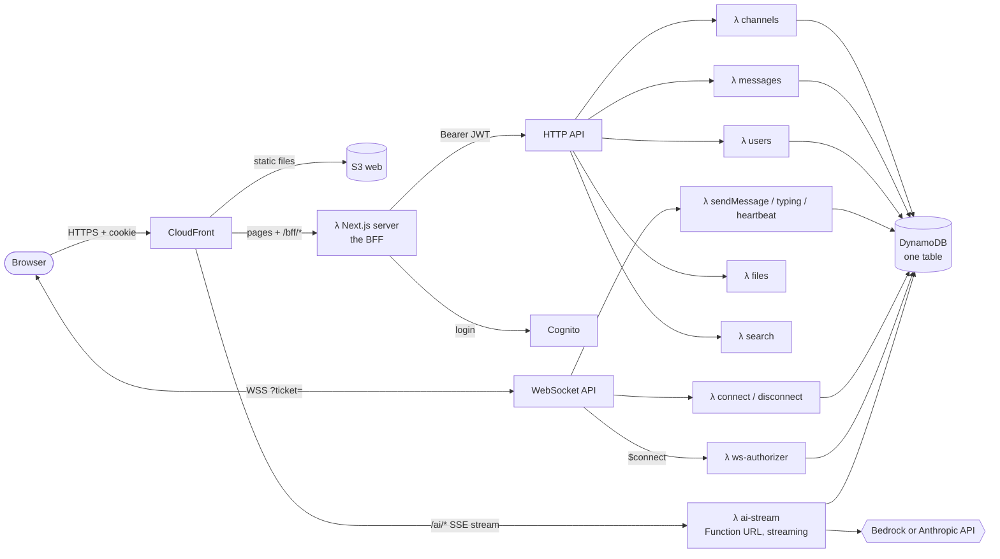
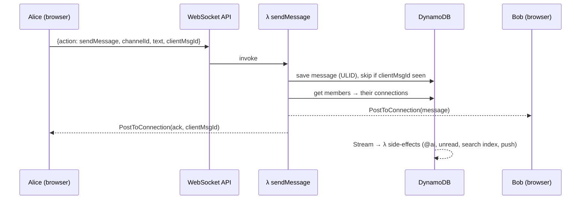
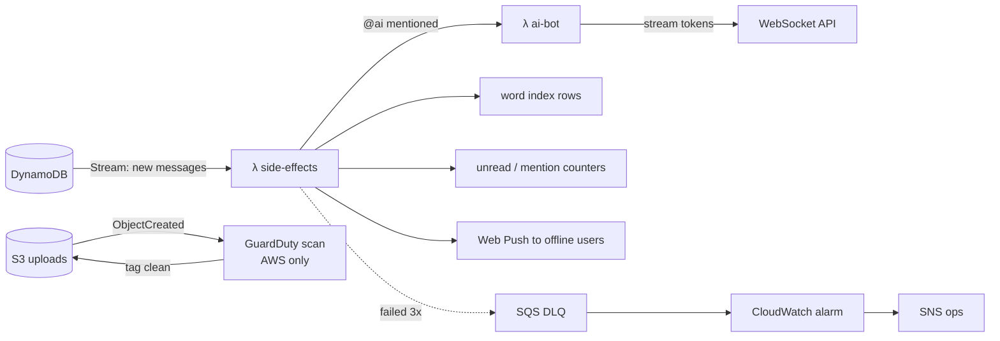

# Architecture (target design)

This is where we're heading. Each step builds one slice. The diagram is the same for Floci and real AWS; only the URLs differ.

## 1. Three ways the browser talks to the backend

| Protocol | Used for | Why this one |
|---|---|---|
| **HTTP** (request → response) | load channels, history, search, upload URLs | simple, cacheable, easy to retry |
| **WebSocket** (two-way, always open) | new messages, typing, presence, @ai in channels | server can push to many people at once |
| **SSE** (one-way stream over HTTP) | your private AI chat reply, word by word | simple, works with cookies, auto-reconnect |

## 2. What happens when you send a message

## 3. Async side effects (event-driven)

## AWS services and the step that adds each

| Service | Job here | Step |
|---|---|---|
| CloudFormation via CDK | creates everything | 1 |
| Lambda | all backend code | 1 |
| API Gateway HTTP API | REST-style endpoints | 1 |
| DynamoDB (+ Streams, TTL) | all data | 1, 5 |
| Cognito | sign up / log in | 2 |
| API Gateway WebSocket API | realtime | 4 |
| Lambda Function URL (streaming) | AI SSE | 5 |
| Bedrock | AI (IAM auth) | 5 |
| SSM Parameter Store | API keys | 5 |
| SQS (DLQ) | failed async work | 6 |
| S3 (+ presigned POST) | files | 7 |
| GuardDuty Malware Protection | file scanning (AWS only) | 7 |
| CloudWatch Logs + Alarms, SNS | ops | 9 |
| CloudFront + S3 web | hosting | 10 |
| AWS Budgets, IAM Identity Center | safe real-AWS use | 11 |
